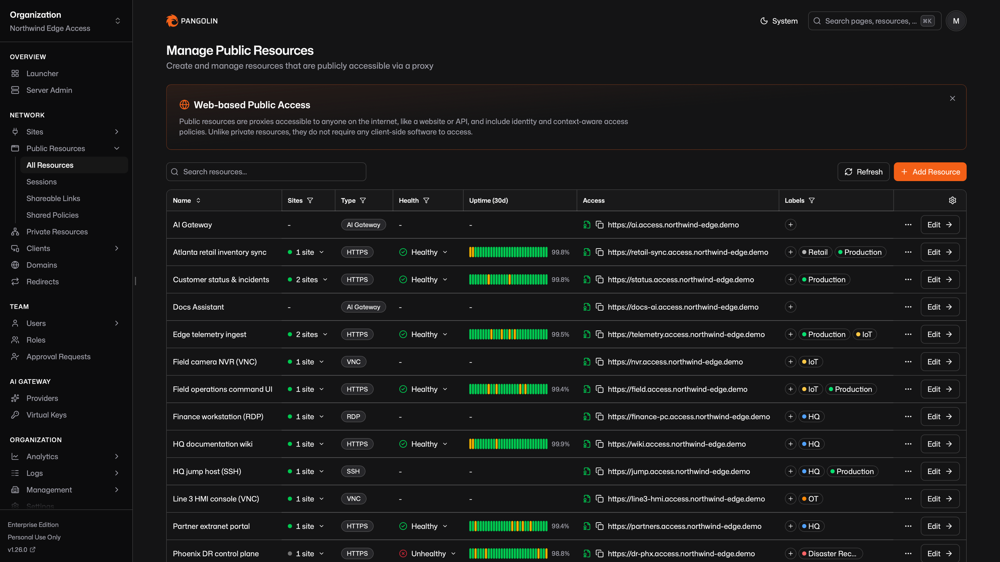
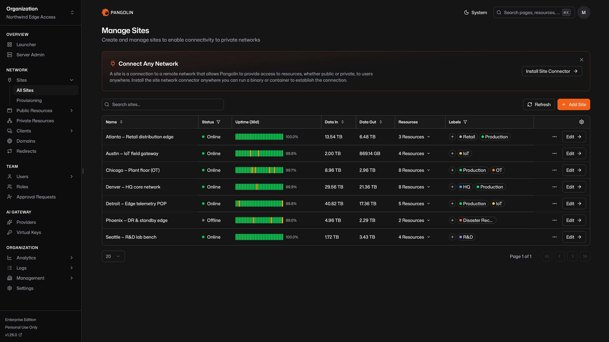
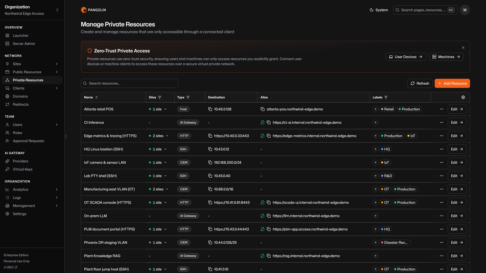
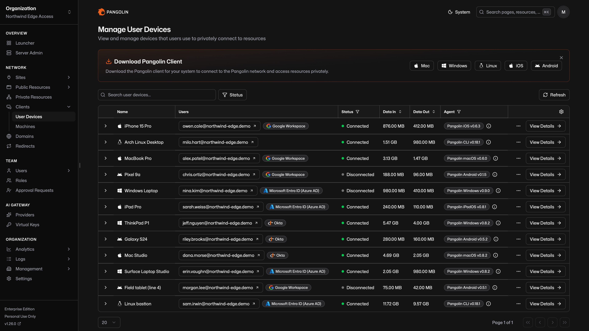
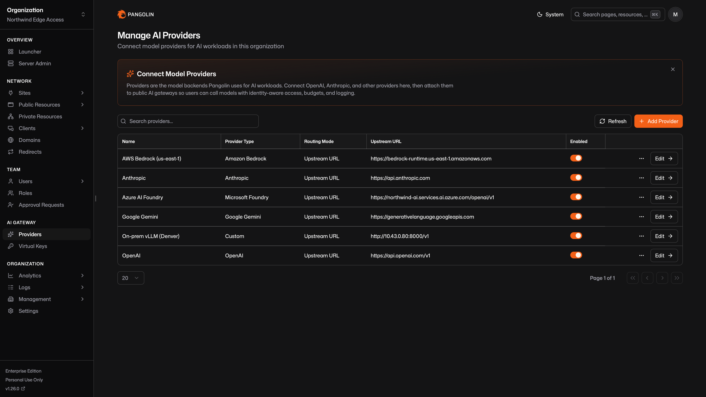
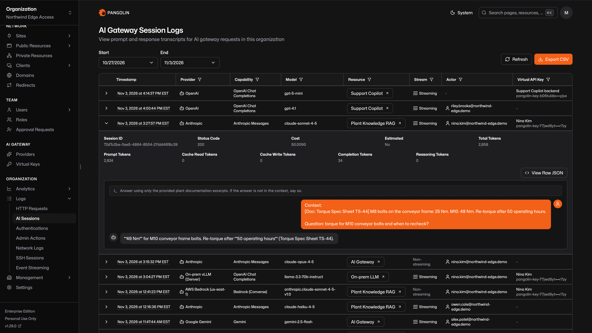
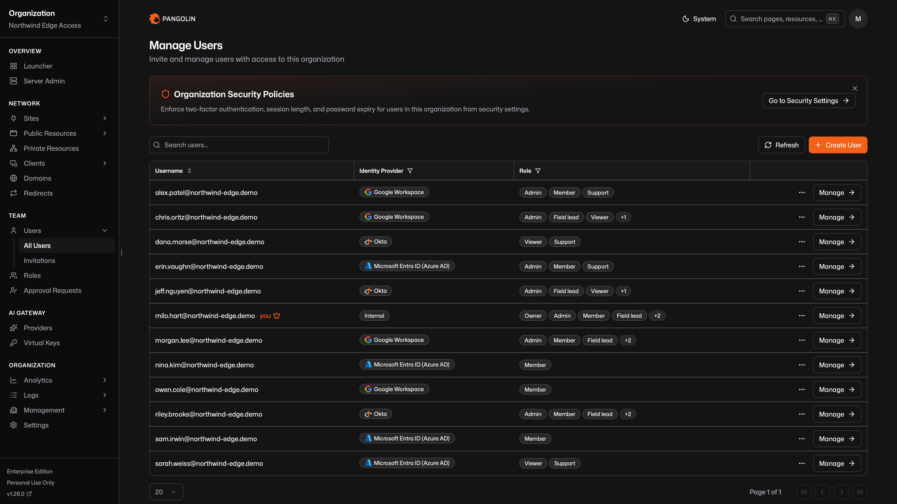
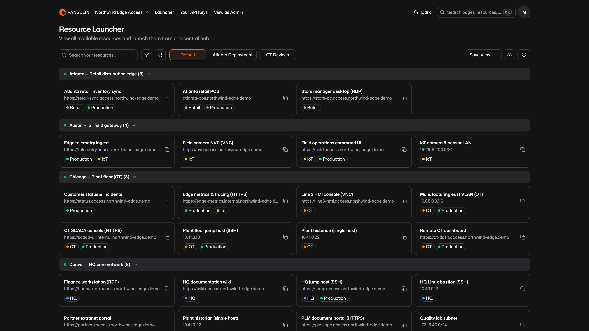
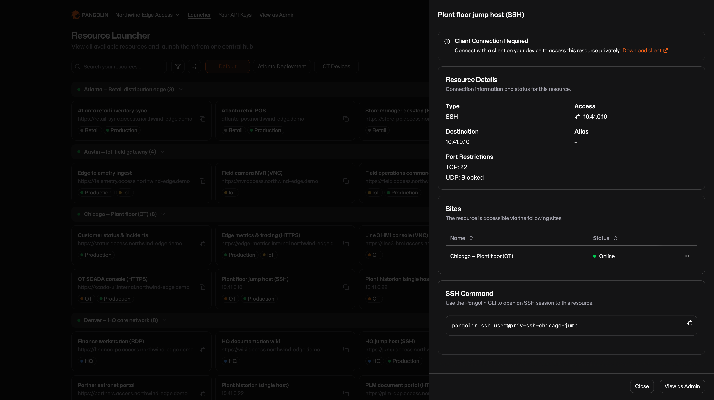

    <h2>
    <a href="https://pangolin.net/">
        <picture>
            <source media="(prefers-color-scheme: dark)" srcset="public/logo/word_mark_white.png">
            
        </picture>
    </a>
    </h2>

  <h5>
      <a href="https://pangolin.net/">
        Website
      </a>
       | 
      <a href="https://docs.pangolin.net/">
        Documentation
      </a>
       | 
      <a href="mailto:contact@pangolin.net">
        Contact Us
      </a>
  </h5>

    <strong>
        Get started with Pangolin Cloud at <a href="https://app.pangolin.net/auth/signup">app.pangolin.net</a>
    </strong>

Pangolin is an open-source platform, built on WireGuard®, for secure access to your apps, infrastructure, and AI. Connect and protect your workforce, AI agents, and infrastructure, wherever they are.

Pangolin gives people access to exactly what their role allows (web apps, SSH, remote desktops, databases, private hosts, and AI models) without exposing anything to the public internet or opening up a whole network with a legacy VPN. Share a link and someone can sign in from a browser, or install a client to reach private resources by name. Every access decision follows identity and gets logged.

### What you get

* **Access in minutes, with just a link**: clientless, browser-based access to web apps, terminals, and remote desktops. No jump boxes, no open ports.
* **A faster, safer VPN replacement**: users reach only the resources they are granted, over direct peer-to-peer connections, signing in with their existing work account.
* **A smaller blast radius**: a compromised login can't roam your network. Sync users and roles from your identity provider and offboard someone once, everywhere.
* **Audits with less work**: every access decision is logged with who, what, and when.
* **AI under the same rules**: an identity-aware AI gateway puts roles, budgets, and session history in front of cloud and self-hosted model APIs, so AI agents follow the same policy as people.

### Why Pangolin

Connectivity and security belong together. SASE platforms like Cloudflare One, Zscaler, and Prisma Access got that idea right, but delivered it as heavyweight, closed, cloud-locked stacks. Pangolin brings them into one platform with a single identity and policy model, and keeps it simple enough that administrators actually enjoy running it.

* **Open source, not a black box**: every component, from the server to the clients, is open and auditable, so you can see exactly how your traffic is handled and how access decisions get made.
* **Lightweight by design**: easy to self-host on a small server, with a lightweight, user-space connector that goes in your private networks.
* **Enjoyable to use**: a clean, modern interface and a setup flow that gets out of your way, instead of a legacy admin console.
* **Run it your way**: self-host the Community Edition for free, step up to the Enterprise Edition for advanced features, or use Pangolin Cloud if you'd rather not manage infrastructure at all. No lock-in.

## Installation

- Get started for free with [Pangolin Cloud](https://app.pangolin.net/).
- Or, check out the [quick install guide](https://docs.pangolin.net/self-host/quick-install) for how to self-host Pangolin.
- Or, deploy in minutes from a prebuilt image on [AWS or DigitalOcean](https://docs.pangolin.net/self-host/one-click-deploy):
  - **AWS:** Community and Enterprise AMIs for x86 and Graviton. Configure at launch with user-data or CloudFormation.
  - **DigitalOcean:** install from the [DigitalOcean marketplace](https://marketplace.digitalocean.com/apps/pangolin-ce-1?refcode=edf0480eeb81) for a one-click pre-configured installer.

## Deployment Options

- **Pangolin Cloud** - Fully managed service with no infrastructure required.
- **Self-Host: Community Edition** - Free, open-source, and licensed under AGPL-3.
- **Self-Host: Enterprise Edition** - Open-core, and licensed under Fossorial Commercial License. Free for personal and hobbyist use, and for businesses making less than \$100K USD gross annual revenue.

## Key Features

### Connect remote networks with sites and NAT traversal

Pangolin's site connectors provide gateways into networks so you can access any networked resources. Sites use outbound tunnels and intelligent NAT traversal to make networks behind restrictive firewalls available for authorized access without public IPs or open ports. Easily deploy a site as a binary or container on any platform.

* Lightweight user-space connector runs anywhere
* Punches through any firewall
* Doesn't require open ports or a public IP
* Strict network segmentation
* WireGuard-based
* Get alerts when a device or network resource goes down

### Browser-based reverse proxy access

Expose HTTPS web applications and connect to VNC, RDP, and SSH entirely in the browser through identity and context-aware tunneled reverse proxies. Users access resources with authentication and granular access control without installing a client. Pangolin handles routing, load balancing, health checking, and automatic SSL certificates without exposing your network directly to the internet.

* Expose a web panel anywhere
* Access via any web browser
* Single sign-on across all resources
* HTTPS resources
* Remote desktop in the browser with VNC and RDP
* In-browser SSH terminal with privileged access management (PAM)
* PIN codes, passcodes, email OTP, geoblocking, allow-lists, and more

### Client-based private resource access

Access private resources like SSH servers, databases, RDP, and entire network ranges through Pangolin clients. Intelligent NAT traversal enables connections even through restrictive firewalls, while DNS aliases provide friendly names and fast connections to resources across all your sites. Add redundancy by routing traffic through multiple connectors in your network.

* Peer-to-peer with intelligent NAT traversal
* Hosts/IPs and port ranges
* Network ranges/CIDRs
* Friendly DNS aliases for network addresses
* Privileged access management (PAM) with SSH resources
* Private HTTPS resources only accessible on the private network

### Identity-aware AI gateway

Put an identity-aware proxy in front of public cloud (OpenAI, Anthropic, Gemini, etc.) and self-hosted model servers (Ollama, vLLM, Mistral, etc.) so coding agents and AI clients call a single Pangolin URL. Publish it as a public resource with personal API keys, or keep it private on a client tunnel where the connected client is the credential for keyless access. Budgets, session history, and usage analytics sit in front of every call.

* Access self-hosted models (vLLM, Ollama, etc) alongside cloud models (OpenAI, Anthropic, etc) in one place
* Keyless access by authenticating users with the Pangolin desktop client
* Or, provide users with personal API keys
* Control costs and token usage by setting budgets
* Audit with detailed session history and analytics
* Integrate AI clients and coding agents (Claude Code, Codex, OpenCode, etc)

### Give users and roles access to resources

Use Pangolin's built-in users or bring your own identity provider and set up role-based access control (RBAC). Grant users access to specific resources, not entire networks. Unlike traditional VPNs that expose full network access, Pangolin's zero-trust model ensures users can only reach the applications, services, and routes you explicitly define.

* Bring your existing identity provider (IdP) or use Pangolin identities
* Sync users and roles from your IdP
* User- and role-based access control
* Full network audit and access logs

### Find and launch resources from a personalized home page

Give users a landing page to quickly find and open the resources they can access. Resources are grouped by site or label, searchable, and filterable, with grid or list views. Saved views capture filters, grouping, and layout as personal or organization-wide defaults.

* Single place for admins and non-admins to see accessible resources
* Create reusable views for common access patterns

## Download Clients

Download the Pangolin client for your platform:

- [Mac](https://pangolin.net/downloads/mac)
- [Windows](https://pangolin.net/downloads/windows)
- [Linux](https://pangolin.net/downloads/linux)
- [iOS](https://pangolin.net/downloads/ios)
- [Android](https://pangolin.net/downloads/android)

## Get Started

### Sign up now

Create a free account at [app.pangolin.net](https://app.pangolin.net) to get started with Pangolin Cloud.

### Check out the docs

We encourage everyone to read the full documentation first, which is
available at [docs.pangolin.net](https://docs.pangolin.net). This README provides only a very brief subset of
the docs to illustrate some basic ideas.

## Licensing

Pangolin is dual licensed under the AGPL-3 and the [Fossorial Commercial License](https://pangolin.net/fcl). For inquiries about commercial licensing, please contact us at [contact@pangolin.net](mailto:contact@pangolin.net).

## Contributions

Please see [CONTRIBUTING](./CONTRIBUTING.md) in the repository for guidelines and best practices.
